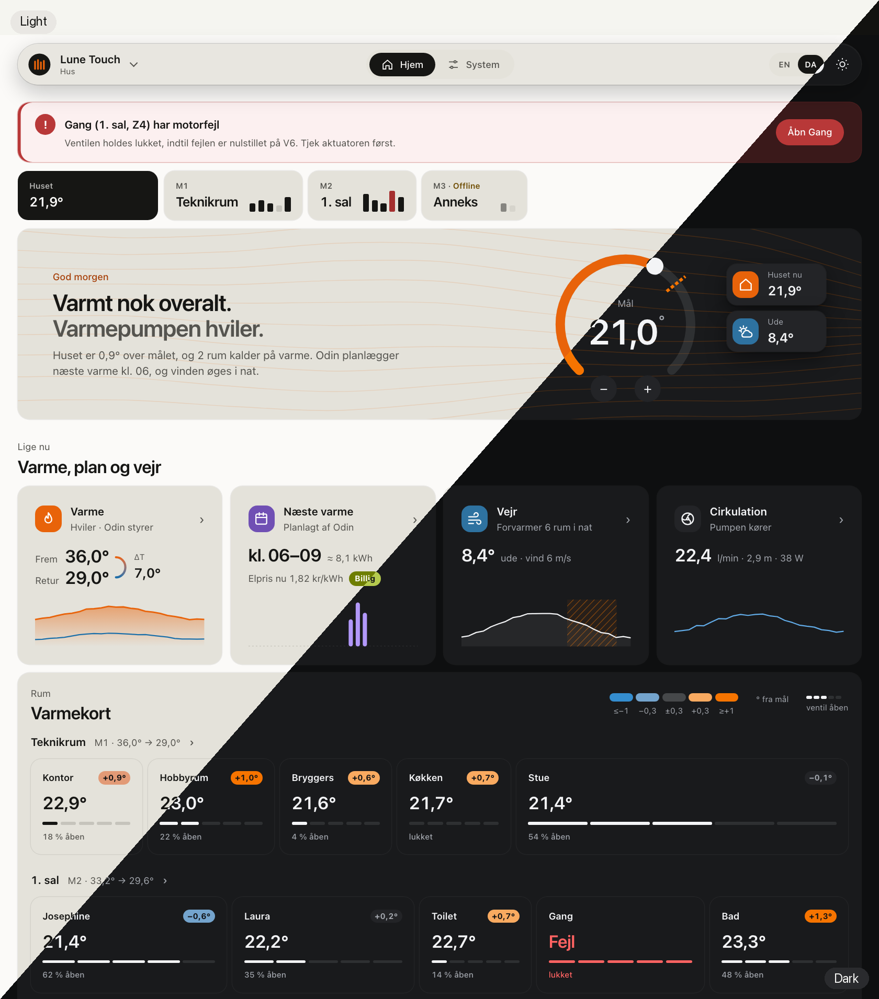

# Lune Design System 2

Shared design system for **Lune V6** and **Lune Touch**: tokens, CSS components, rules and a visual reference. Built for the ESP32: plain CSS/HTML, state without JavaScript, no external resources.

**Documentation:** [docs/README.md](docs/README.md) — index of the design system's documents, with links to Lune V6 and Lune Touch.

**Repo:** https://github.com/Birkemosen/lune-design-system



Design changes land **here first**, then the products are rebuilt. Never change only the copied CSS/HTML in a product repo. See [`CHANGELOG.md`](CHANGELOG.md).

| File | Contents |
|---|---|
| [`DESIGN.md`](DESIGN.md) | Principles, colour meaning, typography, layout, all components, patterns, language, i18n, budget, Touch architecture, checklist |
| [`AGENTS.md`](AGENTS.md) | Short rules for coding agents — copy into the project's `CLAUDE.md` |
| `tokens/tokens.json` | All values (light + dark) and contrast requirements |
| `css/lune-ui.src.css` | Components and layout (source) |
| `config/v6.json`, `config/touch.json` | The project's modes (Home/System), System categories and flags (`heat_source_types`, `typed_groups`) |
| `tools/lds_build.py` | Builds `dist/<project>/lune-ui.css` and checks contrast |
| `tools/build_docs.py` | Builds `docs/design-system.html` |
| `tools/lds_ha.py` | Builds the Home Assistant theme (`dist/home-assistant/`) |
| `tools/lds_shots.py` | README screenshot: a preview in light and dark, split diagonally (`python tools/lds_shots.py PREVIEW.html OUT.png --height 1430`) |
| `tools/lds_display.py` | Builds the wall display's LVGL theme (`dist/display/lune_theme.h` and an ESPHome package); `--install` writes the firmware files into the product repo |
| `tools/lds_brand.py`, `tokens/brand.json` | Brand marks (six-pipe halo) as PNG/SVG |
| `tools/md_toc.py` | Tables of contents in Markdown (`<!-- toc -->`), e.g. in `DESIGN.md` and the manuals |
| `js/lune-forms.js` | Unsaved/save, autosave and popover placement (progressive) |
| `examples/v6/` | V6 on the system (Home, zone and manifold sheets, System), with en/da and `web_ui.h` |
| `examples/touch/` | Touch on the system: Home with the thermostat ring, tiles and heat map, sheets and System |

The documents themselves (`DESIGN.md`, `AGENTS.md`, `CHANGELOG.md`) are in Danish.

## Getting started

```bash
python tools/lds_build.py --check              # every colour pair ≥ its requirement?
python tools/lds_build.py config/v6.json       # → dist/v6/lune-ui.css(.gz)
python tools/lds_build.py config/touch.json    # → dist/touch/lune-ui.css(.gz)
python tools/build_docs.py                     # → docs/design-system.html
python tools/lds_display.py                    # → dist/display/lune_theme.{h,yaml}
python tools/lds_ha.py                         # → dist/home-assistant/themes/lune.yaml
python examples/v6/build_ui.py --langs en,da   # → examples/v6/dist (pages + web_ui.h)
python examples/v6/check_fields.py             # no old fields lost, group limits
python examples/touch/build_ui.py --langs en,da --preview --hs-type asgard
```

An unknown value in `heat_source_types` or `typed_groups` fails the build with a clear message.

## In the two projects

Add the folder as a git submodule (or a copy) in each repo, e.g. `web/design-system/`. The project's own build calls `lds_build.py` with its config and uses `dist/<project>/lune-ui.css`. Pages are built after the pattern in `examples/v6/build_ui.py`: state inputs before `.app`, one `section.view` per mode × scope, texts from the i18n catalogue.

- **Lune V6** (`Birkemosen/lune`): `lds.yaml` → this repo; `make design-tokens` / dashboard build → `lune-v6/web/ui/`
- **Lune Touch** (`Birkemosen/lune-coordinator`): keep `web/design-system/` in sync; build with `make touch-ui`. The Touch architecture is in `DESIGN.md` sections 10 and 5.2.1.
- **Lune Touch wall display (LVGL)**: `lds.yaml` (schema 2) → `make design-tokens` runs `tools/lds_display.py --install` and writes `lune_theme.h`, `tokens.generated.yaml`, `lune_design_tokens.h`, brand PNGs and `logo.svg` from `display` in `tokens/tokens.json` and `tokens/brand.json`. `make design-verify` does the same with `--check`.

## License

[GPL-3.0-or-later](LICENSE) — the same license as the firmware that embeds the design system.

"Lune" identifies this project. Forks must use a different name and must not present
themselves as Lune or as endorsed by this project.

## Support the project

Lune is developed in spare time and paid for out of pocket. If you want to give something
back, you can sponsor it through [GitHub Sponsors](https://github.com/sponsors/Birkemosen).

If you use the design system, a small one-time thank-you is welcome but never expected.
Sponsoring comes with no rewards or promises: Lune is built at its own pace.
